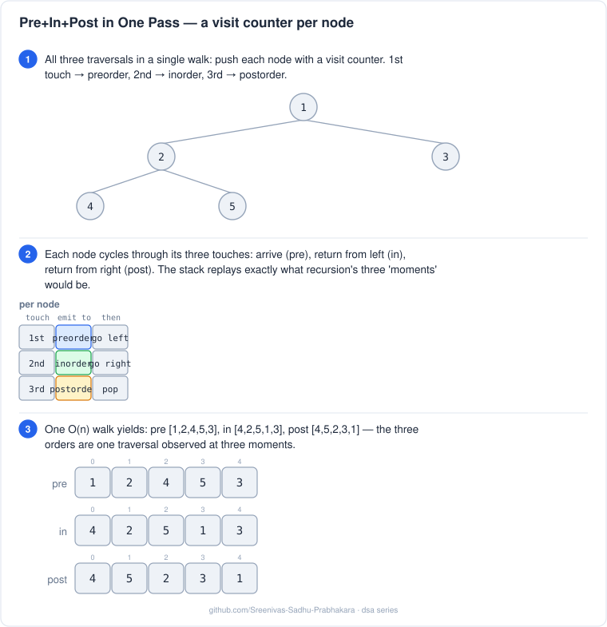

# Pre/In/Postorder in One Traversal

> Striver SDE Sheet 112 · Day 17 Binary Tree — one stack of (node, visit-count) frames; the count says which list the node joins next. Go, stdlib only, tested.

## Problem

Produce preorder, inorder and postorder in a single walk of the tree — not three separate traversals.

## Approach

Recursion visits every node three times — before the left subtree, between the subtrees, after the right subtree — and the three traversals differ only in *which* visit emits. Make that explicit: each stack frame carries a state 1/2/3. State 1 emits to preorder and pushes the left child; state 2 emits to inorder and pushes the right; state 3 emits to postorder and pops. The frame's state mutation in place (`top := &stack[...]`) is what keeps a node's identity across its three visits. This is the cleanest mental model of what the call stack does in recursive traversal — worth one repo on its own.

**Complexity:** O(n) time (each node visited 3 times), O(h) stack.

## Visual walkthrough

Read the picture top to bottom — each numbered frame is one moment of the algorithm
running on this repo's test example.

## Run

    go test ./...   # verify
    go run .        # demo

---

One of 191 repos solving Striver's SDE Sheet in Go — stdlib only, one problem per repo, every solution tested. Browse the set: [`dsa-*` repos](https://github.com/Sreenivas-Sadhu-Prabhakara?tab=repositories&q=dsa-&type=source).
